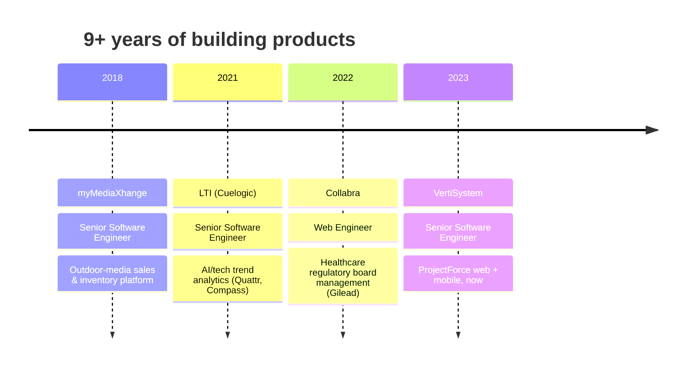

<!-- Header -->
<p align="center">
  
</p>

<p align="center">
  <a href="https://git.io/typing-svg"></a>
</p>

<p align="center">
  <a href="https://portfolio-zeta-beige-cx4xm0hemu.vercel.app/"></a>
  <a href="https://www.linkedin.com/in/paritosh-mahale-536020156/"></a>
  <a href="mailto:hello.paritoshmahale@gmail.com"></a>
  
</p>

<p align="center">
  
  
</p>

---

## 🧭 About Me

I'm a **Senior Software Engineer with 9+ years of experience** building scalable, high-performance web and mobile applications. I own features end-to-end — from architecture and data modelling to deployment and maintenance — and I care about clean, production-ready code and tight collaboration with product, design and QA.

**What I bring**
- 🏗️ **Architecture** — designed a GraphQL-based platform serving **100K+ users**
- 📱 **Cross-platform delivery** — led frontend for a React Native mobile app + web platform
- 🤖 **AI in production** — integrating LLM workflows that improve real user experiences
- ⚡ **Performance** — 20% faster load times through data-fetching optimisation
- 🤝 **Client-facing leadership** — requirement gathering, sprint estimation and team coordination

**Domains:** Project management SaaS · Healthcare / regulatory · AI trend analytics · Ad-tech & media

---

## 🧰 Tech Stack

<table>
  <tr>
    <td align="center" width="140"><b>Frontend</b></td>
    <td></td>
  </tr>
  <tr>
    <td align="center"><b>Backend</b></td>
    <td> &nbsp;  </td>
  </tr>
  <tr>
    <td align="center"><b>Databases</b></td>
    <td></td>
  </tr>
  <tr>
    <td align="center"><b>Cloud &amp; DevOps</b></td>
    <td></td>
  </tr>
  <tr>
    <td align="center"><b>Mobile</b></td>
    <td> </td>
  </tr>
  <tr>
    <td align="center"><b>Tooling</b></td>
    <td> &nbsp;  </td>
  </tr>
</table>

---

## 💼 Career Journey



<details open>
<summary><b>🟢 VertiSystem — Senior Software Engineer</b> · <i>Jan 2023 – Present · Remote</i></summary>
<br/>

**Product:** ProjectForce — project management platform (web + cross-platform mobile)
- Led frontend development for the mobile app and web platform
- Architected a web platform serving **100K+ users** on **GraphQL** APIs
- Integrated **AI/LLM workflows** to enhance the user experience
- Owned bug triage and code-quality standards across the team

`React` `React Native` `TypeScript` `GraphQL` `Apollo` `Redux Toolkit` `AI/LLM`
</details>

<details>
<summary><b>🔵 Collabra — Web Engineer</b> · <i>Jul 2022 – Jan 2023 · Hybrid</i></summary>
<br/>

**Product:** Regulatory Board Management system for Gilead (healthcare)
- Built core features for a compliance-critical healthcare platform
- Wrote a React wrapper component to integrate a third-party JS library cleanly
- Improved component modularity, **reducing code complexity by 15%**

`React` `JavaScript` `REST APIs`
</details>

<details>
<summary><b>🟣 LTI (Cuelogic) — Senior Software Engineer</b> · <i>Apr 2021 – Jul 2022 · Pune</i></summary>
<br/>

**Products:** Quattr & Compass — AI/tech trend analysis platforms
- Built the platforms end-to-end: data ingestion through visualisation
- Delivered core features with **Next.js** and **PostgreSQL**; auth with **AWS Cognito**
- Optimised data fetching, **improving load times by 20%**
- Ran client communication and requirement gathering for Quattr

`Next.js` `PostgreSQL` `AWS Cognito` `Data Visualisation`
</details>

<details>
<summary><b>🟠 myMediaXhange — Senior Software Engineer</b> · <i>Aug 2018 – Apr 2021 · Pune</i></summary>
<br/>

**Product:** Outdoor Media Solutions — sales & inventory platform for outdoor advertising
- Led solution and **MySQL** database design for core modules
- Built **RESTful APIs** for third-party advertising integrations
- Handled client coordination and sprint estimation

`Node.js` `MySQL` `REST APIs` `jQuery`
</details>

---

## 📊 GitHub at a Glance

<p align="center">
  
  
</p>

<p align="center">
  
</p>

---

## 🎯 Right Now

```ts
const paritosh = {
  role: "Senior Software Engineer @ VertiSystem",
  experience: "9+ years",
  focus: ["Scalable React / Next.js architecture", "GraphQL APIs", "AI/LLM product features"],
  exploring: ["Agentic AI workflows", "Edge rendering", "Platform performance"],
  openTo: ["Senior / Lead engineering roles", "Interesting collaborations"],
  reachMe: "hello.paritoshmahale@gmail.com",
};
```

<p align="center">
  
</p>
